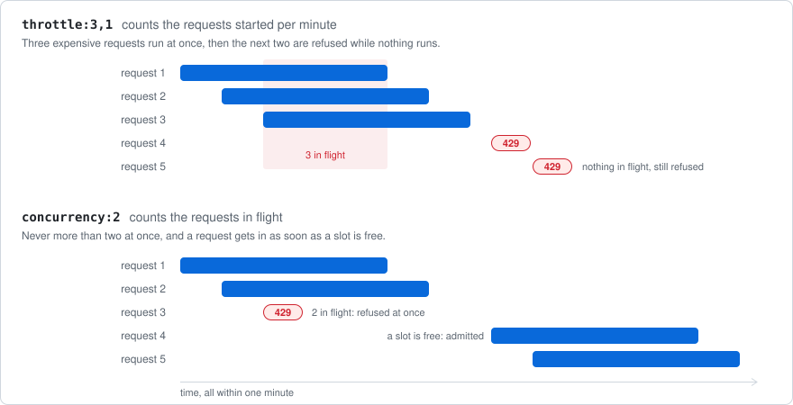

# Laravel Concurrency Limit

[](https://packagist.org/packages/largerio/laravel-concurrency-limit)
[](https://github.com/largerio/laravel-concurrency-limit/actions/workflows/ci.yml)
[](composer.json)
[](LICENSE.md)

Limit how many executions run at the same time for one key of your
application: a user, a tenant, a resource. It covers HTTP requests and queued
jobs.

Each key has a small number of **slots**. A request or a job takes a slot
when it starts and gives it back when it ends. When every slot of its key is
taken, a request gets a `429` and a job goes back to the queue. This is
application-level fairness: one user, tenant or resource cannot hold more
than N executions at once, so it cannot monopolise the workers everyone else
needs.

Laravel can limit a *rate* (`throttle`, `RateLimited`) and can run a closure
under a concurrency cap (`Cache::funnel()`). It has no HTTP middleware that
caps the requests in flight, and no job middleware that lets N jobs run at
once (`WithoutOverlapping` lets one). This package adds both.



```php
ConcurrencyLimit::for('exports', fn (Request $request) => Slots::max(2));

Route::post('/exports', ExportController::class)->middleware(['auth', 'concurrency:exports']);
```

- [When to use it](#when-to-use-it)
- [Installation](#installation)
- [Quick start](#quick-start)
- [How slots work](#how-slots-work)
- [HTTP middleware](#http-middleware)
- [Job middleware](#job-middleware)
- [When the cache store fails](#when-the-cache-store-fails)
- [Cache stores](#cache-stores)
- [Events](#events)
- [Testing your application](#testing-your-application)
- [Configuration](#configuration)
- [Octane](#octane)
- [Credits](#credits)
- [Contributing](#contributing)
- [License](#license)

Reference: [HTTP middleware](docs/http.md) · [Job middleware](docs/jobs.md) ·
[Cache stores](docs/stores.md)

## When to use it

| You want to | Use |
|---|---|
| Protect the server as a whole from overload | Infrastructure: nginx `limit_conn`, Traefik `InFlightReq`, Envoy adaptive concurrency, PHP-FPM `pm.max_children` |
| Cap requests per minute | `throttle:` / `RateLimiter` |
| Cap one block of code (an API call inside a service) | `Cache::funnel()` directly |
| Cap the HTTP requests in flight per user, tenant or key | `concurrency:{name}` (this package) |
| Let at most N jobs run at once per key | `ConcurrencyLimited` (this package) |
| Hold a slot while a response streams | This package (`Cache::funnel()` releases its slot when its callback returns) |

Rate and concurrency limits complement each other: `throttle` stops many
cheap requests, `concurrency` stops a few expensive ones (exports, reports,
AI calls). Limits are meant to be small, from 1 to about 20 per key.

Out of scope: adaptive limits, metrics storage or endpoints, Artisan
commands, server-wide limits, and serving waiting requests in arrival order.

## Installation

Requires PHP 8.4 or later, Laravel 13.40 or later (`laravel/framework`), and
a cache store with atomic locks, such as Redis, Memcached or the database
store (see [Cache stores](#cache-stores)).

```bash
composer require largerio/laravel-concurrency-limit
```

The service provider and the `ConcurrencyLimit` facade are discovered
automatically. Publishing the configuration file is optional:

```bash
php artisan vendor:publish --tag=concurrency-limit-config
```

## Quick start

The shortest form caps routes with no setup:

```php
Route::post('/exports', ExportController::class)->middleware(['auth', 'concurrency:2']);
```

Each user, or each IP address for guests, now has at most 2 requests in
flight. The third gets a `429 Too Many Requests` with `Retry-After: 1`
immediately, without reaching the controller. Routes that use this form
without a pool name share one pool; `concurrency:2,exports` counts a route
on its own (see the [inline form](docs/http.md#inline-form)).

For anything more than a number, register a named limiter, then put it on
routes:

```php
// app/Providers/AppServiceProvider.php
use Illuminate\Http\Request;
use Largerio\ConcurrencyLimit\Facades\ConcurrencyLimit;
use Largerio\ConcurrencyLimit\Slots;

public function boot(): void
{
    ConcurrencyLimit::for('api', fn (Request $request) => Slots::max(10)->by($request->user()->team_id));
}
```

```php
// routes/api.php
Route::middleware(['auth:sanctum', 'throttle:api', 'concurrency:api'])->group(function () {
    // ...
});
```

Each team now has at most 10 requests in flight on these routes.

To cap queued jobs, give them the job middleware:

```php
use Largerio\ConcurrencyLimit\Queue\Middleware\ConcurrencyLimited;

public int $tries = 0;

public function retryUntil(): DateTime
{
    return now()->addHour();
}

public function middleware(): array
{
    return [new ConcurrencyLimited("outlook-{$this->calendar->provider_id}", 4)];
}
```

At most 4 of these jobs run at once per provider, and a job that finds no
free slot is released back to the queue. **Set `$tries = 0` and
`retryUntil()`**: Laravel counts every release as an attempt, so with the
default of one try the first release would fail the job (see
[Job middleware](#job-middleware)).

## How slots work

Each pool, a limiter and a key, has `max` slots, and each slot is one cache
lock, taken with the store's atomic lock operation:

```
concurrency:{xxh128 hash of the limiter and the key}:{slot number}
```



- A request tries the slots once each, starting from a random one, and takes
  the first free one. Each slot has its own TTL (`expireAfter()`), so a
  process that dies holding a slot frees it when the TTL runs out. No cleanup
  command is needed.
- A slot is released with the lock's owner token: a release that comes after
  the slot expired cannot free a slot someone else has taken since.
- There is no counter to drift. Raising or lowering `max` between deploys is
  safe: slots are numbered, and a lower limit stops handing out the high
  ones.
- Each operation touches a single key, so Redis Cluster works.
- Keys are hashed with xxh128 together with the limiter name, byte for byte,
  so any string works, binary data included: they have a fixed length, fit
  every store's key limits, and don't appear in clear text in the cache.
  xxh128 is not a cryptographic hash, though: anyone who can read the cache
  can still test guesses.

The cost is in round trips to the store: a rejection tries every slot, so it
costs `max` round trips, and so does every poll of a waiting request. That
is why limits are meant to be small.

## HTTP middleware

A limiter receives the request and returns a `Slots`: how many executions a
key may hold, and what happens when they are all taken. It can also return an
array of `Slots`, or `null` for no limit on this request.

```php
// Count per team rather than per user.
ConcurrencyLimit::for('exports', fn (Request $request) => Slots::max(3)->by($request->user()->team_id));

// Several limits, granted all or none.
ConcurrencyLimit::for('exports', fn (Request $request) => [
    Slots::max(2)->by("user:{$request->user()->id}"),
    Slots::max(10)->by("team:{$request->user()->team_id}"),
]);

// Wait up to 2 seconds for a slot rather than reject immediately.
ConcurrencyLimit::for('checkout', fn () => Slots::max(1)->block(2));

// A limit that depends on the plan, and none for staff.
ConcurrencyLimit::for('ai', fn (Request $request) => $request->user()->isStaff()
    ? null
    : Slots::max($request->user()->plan->concurrency));
```

With `block()`, a request waits for a slot, up to the time given, rather than
being rejected immediately:



### `Slots`

| Method | Default | Meaning |
|---|---|---|
| `Slots::max(int $max)` | required | Maximum simultaneous executions per key. At least `0`; `0` always rejects, immediately, even with `block()`. |
| `->by(string\|int $key)` | user, else IP | Key the limit is counted against. |
| `->block(int\|float $seconds)` | `0` | Opt-in: wait up to this long for a slot before rejecting. At least `0`. |
| `->expireAfter(int $seconds)` | `60` | Slot TTL: when a slot frees itself if it is never released. At least `1`. |
| `->retryAfter(int $seconds)` | `1` | Value of the `Retry-After` header on rejection. At least `0`; `0` sends no header. |
| `->response(Closure $callback)` | 429 exception | Custom rejection response. |
| `->failOpen()` / `->failClosed()` | config `fail_open` | Behavior when the cache store fails. |

The middleware runs after authentication and `throttle`, whatever order the
route lists them in. It holds the slot until the response is ready, and
until the body ends for a streamed response.

The [HTTP reference](docs/http.md) covers:

- [named limiters](docs/http.md#named-limiters) and the
  [inline form](docs/http.md#inline-form);
- [keys](docs/http.md#keys), the default key, and guests behind
  [trusted proxies](docs/http.md#trusted-proxies);
- [multiple limits](docs/http.md#multiple-limits),
  [waiting for a slot](docs/http.md#waiting-for-a-slot) and the
  [rejection response](docs/http.md#rejection-response);
- [middleware order](docs/http.md#middleware-order),
  [when a slot is released](docs/http.md#when-a-slot-is-released), and
  [long requests and interrupted streams](docs/http.md#long-requests-and-interrupted-streams).

## Job middleware

`ConcurrencyLimited` lets at most N jobs run at once per key. A job that
finds no free slot is released back to the queue, to try again later.

```php
use DateTime;
use Illuminate\Contracts\Queue\ShouldQueue;
use Illuminate\Foundation\Queue\Queueable;
use Largerio\ConcurrencyLimit\Queue\Middleware\ConcurrencyLimited;

class SyncCalendar implements ShouldQueue
{
    use Queueable;

    public int $tries = 0;

    public int $maxExceptions = 3;

    public function __construct(public Calendar $calendar) {}

    public function retryUntil(): DateTime
    {
        return now()->addHour();
    }

    public function middleware(): array
    {
        return [
            (new ConcurrencyLimited("outlook-{$this->calendar->provider_id}", 4))
                ->shared()
                ->releaseAfter(10),
        ];
    }

    public function handle(): void
    {
        // At most 4 of these run at once per provider.
    }
}
```

**Set `$tries`, `retryUntil()` and `$maxExceptions` as above.** Laravel
counts every release as an attempt, as it does with `RateLimited` and
`WithoutOverlapping`. With the default of one try, the first release would
fail the job. So:

- `$tries = 0` lets the job be released as often as it takes;
- `retryUntil()` bounds the time it may keep trying;
- `$maxExceptions` bounds real failures: a release is not an exception, so
  only exceptions thrown by the job count against it.

Before going to production:

- Put limited jobs on a real queue, with `InteractsWithQueue`. A job that
  finds no free slot and cannot be released throws rather than vanish (see
  [Jobs that cannot be released](docs/jobs.md#jobs-that-cannot-be-released)).
- A slot's TTL follows the job's `$timeout`. If your workers run with a
  longer `--timeout`, set `$timeout` on the job or call `expireAfter()` (see
  [Slot TTL](docs/jobs.md#slot-ttl)).

The [job reference](docs/jobs.md) lists the
[constructor and every method](docs/jobs.md#constructor-and-methods):
`releaseAfter()`, `jitter()`, `dontRelease()`, `expireAfter()`, `shared()`,
`withPrefix()`, `failOpen()` and `failClosed()`.

## When the cache store fails

By default a limit fails open: the request or job runs without a slot, and
the failure is reported once, as a `StoreUnavailableException`. This is a
fairness tool, not a security control: a cache blip should neither take an
API down nor burn job attempts.

Where the limit protects something that must not be overrun, such as a
third-party quota, fail closed:

```php
Slots::max(5)->failClosed();
```

A request then gets a `503 Service Unavailable` with `Retry-After`, and a job
is released back to the queue. In both modes the `concurrency` middleware
never turns a store failure into a `500`. The
[details](docs/stores.md#when-the-cache-store-fails) cover the global
default, multiple limits, and how to throttle the reports during an outage.

## Cache stores

Any store with atomic locks (`Illuminate\Contracts\Cache\LockProvider`)
works. The integration tests cover `redis` (with phpredis and with predis),
`memcached`, `database` and `file`. The `array` store is for tests, and the
`null` store grants every slot: a way to turn the package off in one
environment.

The [store notes](docs/stores.md) cover every store, `failover` included,
and three things to know before choosing one: the
[database store inside transactions](docs/stores.md#database-store-and-transactions),
[clock skew](docs/stores.md#clock-skew), and how a dead
[Memcached](docs/stores.md#memcached) is told apart from a full pool.

## Events

All in `Largerio\ConcurrencyLimit\Events`, with public readonly properties:

| Event | Dispatched | Properties |
|---|---|---|
| `SlotAcquired` | Once per slot granted | `string $limiter`, `string $key`, `int $max`, `float $waited` (seconds) |
| `ConcurrencyLimitExceeded` | Once per rejection | `string $limiter`, `string $key`, `int $max`, `float $waited` (seconds) |
| `SlotReleased` | Once per slot released | `string $limiter`, `string $key`, `int $max`, `float $held` (seconds) |

`$key` is the key as given, before hashing. For jobs, `$limiter` is
`job:{JobClass}`, or `job` with `shared()`, and `$key` starts with the
`withPrefix()` prefix, if any; a job skipped with `dontRelease()`, or that
cannot be released, is a rejection too. Nothing is dispatched on a store
failure, whether the limit fails open or closed: the report is the signal.

The counts of `SlotAcquired` and `SlotReleased` stay balanced. If a
`SlotAcquired` listener throws, every slot just taken is released,
`SlotReleased` is dispatched for each `SlotAcquired` already dispatched, and
the listener's exception is rethrown.

Metrics are a listener away:

```php
use Largerio\ConcurrencyLimit\Events\ConcurrencyLimitExceeded;

Event::listen(fn (ConcurrencyLimitExceeded $event) => Metrics::increment("concurrency.rejected.{$event->limiter}"));
```

## Testing your application

There is no `ConcurrencyLimit::fake()`: the real middleware runs in the
test process, on the `array` store. Three recipes cover what you need:

```php
// 1. Nothing to do: with CACHE_STORE=array (Laravel's default in phpunit.xml),
//    the middleware works in-process and never rejects a single request.

// 2. Force the rejection path to test your 429 handling.
ConcurrencyLimit::for('exports', fn () => Slots::max(0));
$this->postJson('/exports')->assertTooManyRequests()->assertHeader('Retry-After', 1);

// 3. Assert a route or job is limited.
Event::fake([SlotAcquired::class]);
$this->post('/exports');
Event::assertDispatched(SlotAcquired::class, fn ($event) => $event->limiter === 'exports');
```

`withoutMiddleware(LimitConcurrentRequests::class)` works as for any
middleware. A limiter that waits (`block()`) waits under `Sleep::fake()`
without slowing the test, and `Sleep::assertSlept()` sees its pauses.

## Configuration

`config/concurrency-limit.php` has two keys. Everything else is set per
limiter, in code, next to the limit it qualifies.

```php
return [
    'store' => env('CONCURRENCY_LIMIT_STORE'),
    'fail_open' => true,
];
```

| Key | Default | Meaning |
|---|---|---|
| `store` | `null`: the default cache store | The cache store that holds the slots. Point it at a dedicated Redis without touching code. |
| `fail_open` | `true` | What happens when the store fails, unless a limit says otherwise ([details](#when-the-cache-store-fails)). |

The defaults, and why:

| Setting | Default | Why |
|---|---|---|
| `Slots::block()` | `0` | Reject immediately. Waiting holds workers and makes overload worse. |
| Rejection status | `429` | The client is over its own limit. `503` is kept for fail-closed. |
| `Slots::retryAfter()` | `1` s | Slots free up when a request ends, usually within a second. Raise it for long-running endpoints. |
| `Slots::expireAfter()` | `60` s | Must exceed the longest request: PHP's default `max_execution_time` is 30 s. Raise it for long streams. |
| Poll interval while waiting | 100 ms ± 50% | Reactive enough for a wait of a second or two. Not configurable. |
| Job `releaseAfter()` | `10` s | Long enough not to spin the queue, short enough to keep the throughput. |
| Job `jitter()` | Half of `releaseAfter`, none for a date | Spreads the retries of jobs rejected together. |
| Job `expireAfter()` | Job timeout + 10 s, else 70 s | Just above the point where the worker kills the job. |

A TTL that is too short over-admits silently: the slot expires while the
work goes on, and one more execution gets in. A TTL that is too long keeps
the slot of a crashed process unavailable for longer. The defaults lean
slightly long.

## Octane

The package keeps no static state and no per-request data on its middleware.
The manager holds only the limiter closures registered at boot, `Slots` are
built per request, and the slots a request holds live on the request itself.
The default key is set on a copy of the `Slots` a limiter returns, so a
`Slots` instance kept between requests never carries one user's key into
another request. The job middleware holds only its settings, so it can be
serialized with the job (`through()`), and it builds its limit for each job it
runs.

## Credits

The job middleware's API follows the one
[@xurshudyan](https://github.com/xurshudyan) proposed in
[laravel/framework#62148](https://github.com/laravel/framework/pull/62148),
itself modelled on `WithoutOverlapping`. The pull request was not merged, and
Laravel's maintainers suggested a package instead. This is an independent
implementation of that API, not the pull request's code, with the HTTP side
added. The [differences](docs/jobs.md#differences-from-laravelframework62148)
are listed in the job reference.

## Contributing

See [CONTRIBUTING.md](CONTRIBUTING.md), and [SECURITY.md](SECURITY.md) to
report a vulnerability. [CHANGELOG.md](CHANGELOG.md) lists the changes of
each release.

## License

The MIT License (MIT). See [LICENSE.md](LICENSE.md).
